

  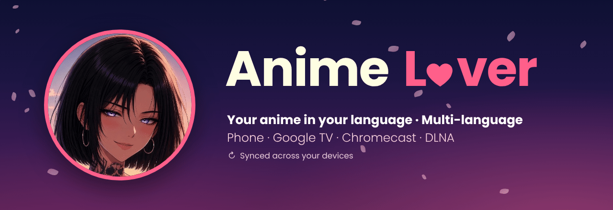

  
  
  
  

<table>
  <tr>
    <td width="150" align="center"></td>
    <td>
      <b>“Hey Lover... I'm Asura ✨”</b>  
      Welcome to <b>AnimeLover</b>, the app to watch your anime <b>in your language</b>: French, English, Spanish,
      Portuguese or Italian
      ( 

 

), subbed or dubbed, on your phone as well as on your <b>Google TV</b>. Pick up your episode right where you left it,
      on whichever device you like, with no ads and no hassle.
    </td>
  </tr>
</table>

  <a href="https://github.com/tad15/AnimeLover/releases/latest"><b>⬇️ Download the latest version</b></a>

## 🌍 Available languages

Pick the language in **Settings › Sources › Source language**: search, home, notifications and the calendar then use only that language's sources.

| Language | Subbed / dubbed | Sources |
|---|---|---|
|  French | VOSTFR / VF | Anime-Sama, VoirAnime, FRAnime, Arkanim, AniZone |
|  English | SUB / DUB | AniZone, KickAssAnime, AnimeGG, Anidap, JustAnime, AnimeParadise, Animo, Aniwaves, AnimeHeaven, Aniwatch, Animenosub, HiAnime, Anikoto |
|  Spanish | SUB ESP / LATINO | Latanime, MonosChinos |
|  Portuguese | LEG / DUB | AniTube, Animes Digital |
|  Italian | SUB ITA / ITA | AnimeSaturn, AnimeWorld |

The app's interface is in **French or English** (Settings › Account › App language).
Sources outside French come from the *Anix* extensions catalog (MIT license), see [CREDITS.md](CREDITS.md).

---

## 📸 Screenshots

  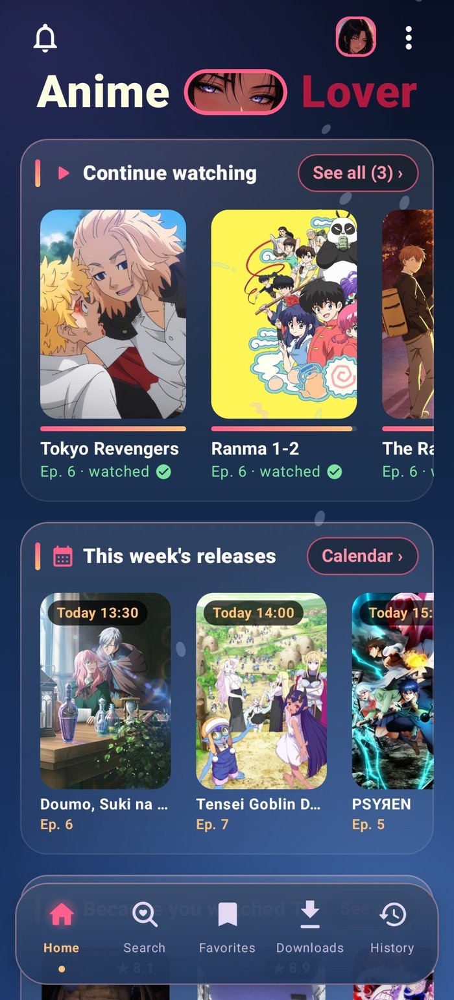
  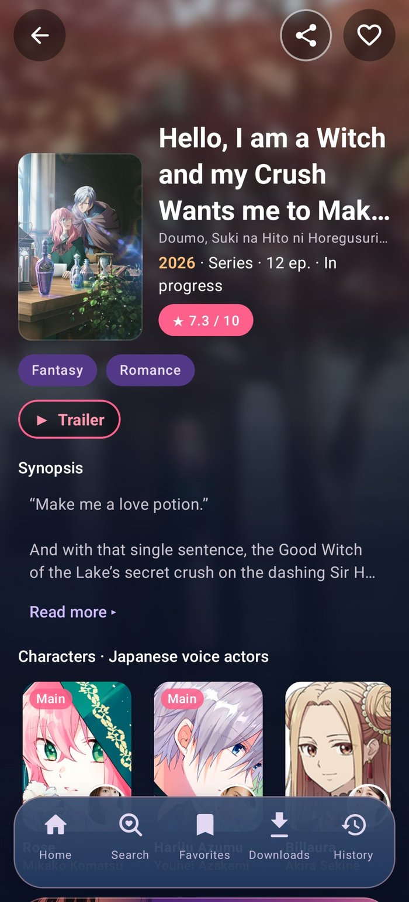
  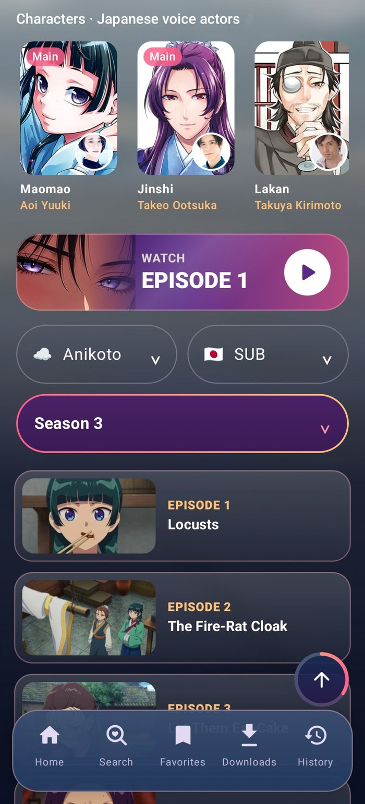

Home (Continue watching, this week's releases) · Anime page with a blurred background image · Source, SUB / DUB and episodes

  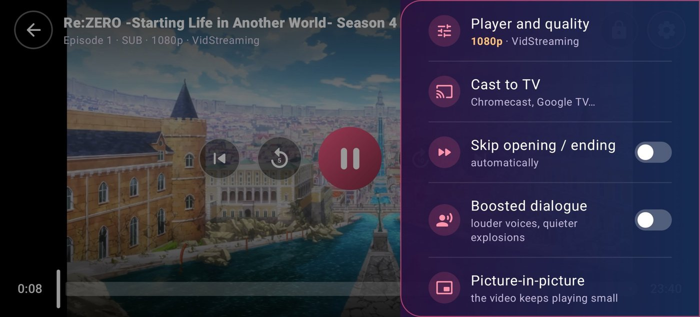

The player and its settings: player and quality, Cast to TV, skip opening / ending, boosted dialogue, picture-in-picture…

  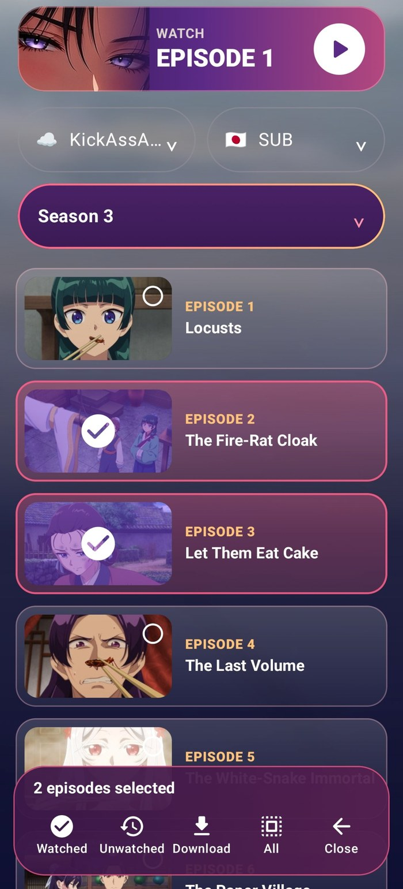
  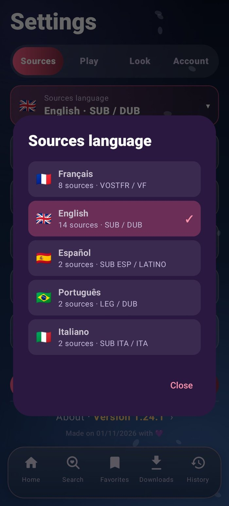
  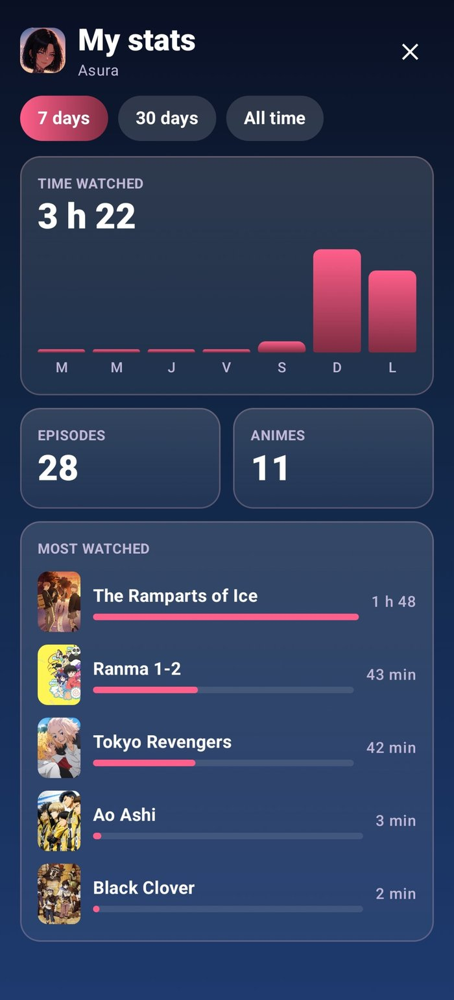
  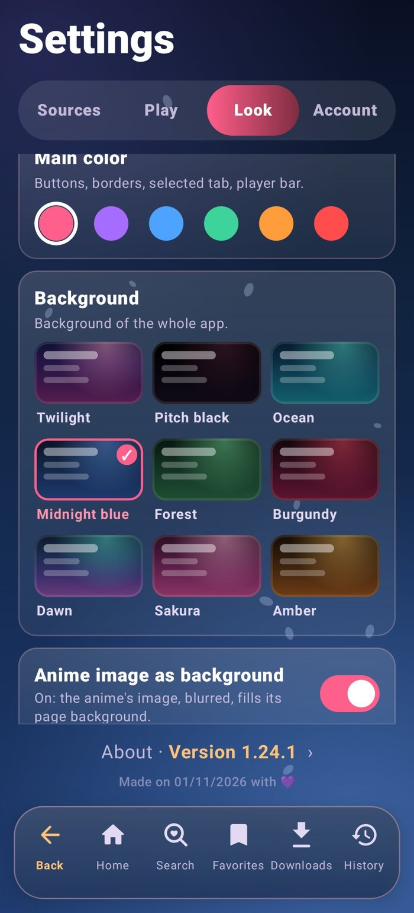

Select episodes (watched, download) · Sources language · My stats · Colors and backgrounds

### 📺 On Google TV

  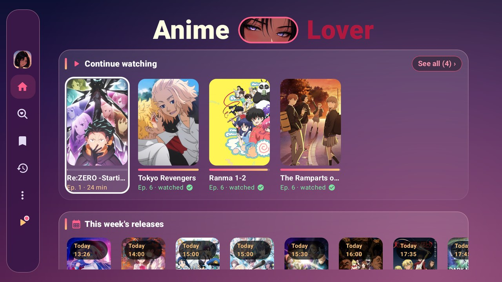
  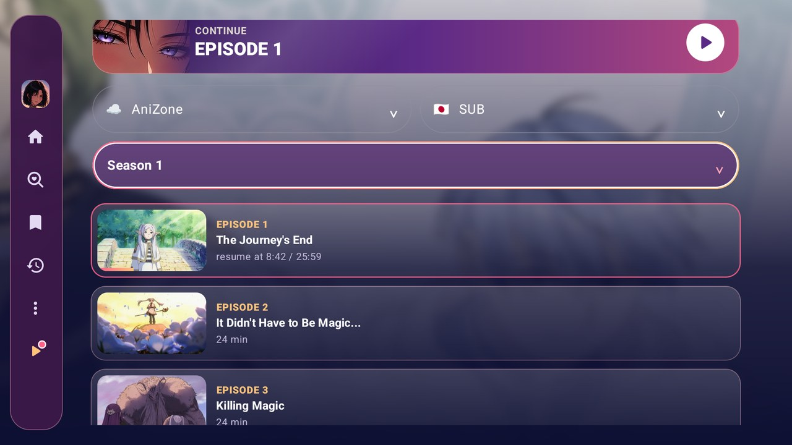

  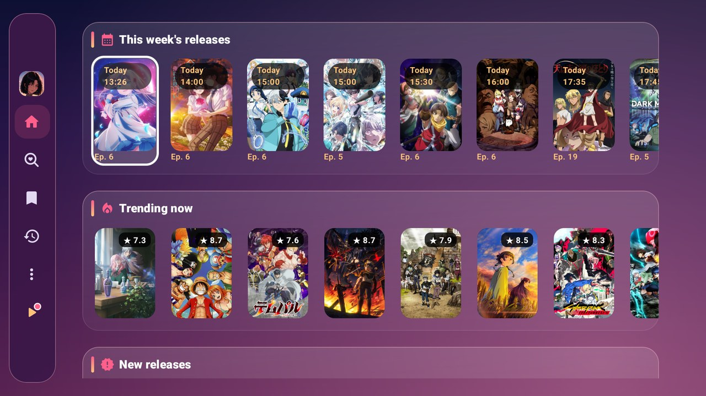
  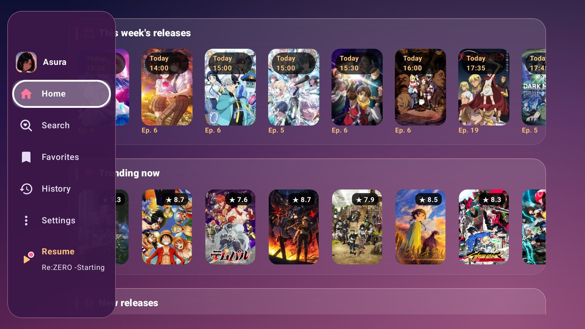

  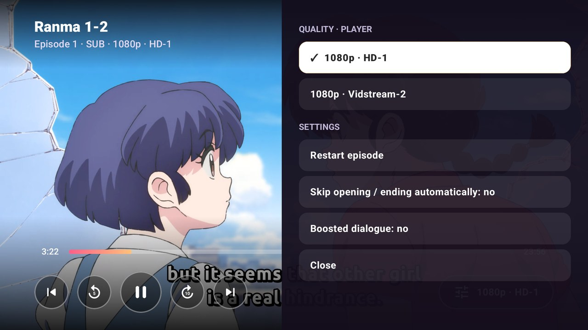

Home with “Continue watching” · Episodes with their titles and images · This week's releases and trending · Side menu with the remote · Player, quality and settings

---

## ✨ What you can do

### 🎬 Watch
- **Several sources per language** gathered in a single search, **subbed or dubbed** (VOSTFR / VF in French).
- A player built for anime: **double tap ±10 s**, **hold for ×2 speed**, screen lock, quality picker.
- **“Skip opening”**: powered by AniSkip, and even **recognized by sound** when AniSkip doesn't know it.
- **Subtitles rendered like on the websites** (libass, the engine used by mpv): translated signs stay in place and follow the picture.
- **Boosted dialogue** to watch at night without waking everyone up.
- **Downloads** to watch offline, subtitles included.

### 📺 On TV
- The same app on **Google TV / Android TV**, designed for the remote.
- **Cast** from your phone to a **Chromecast**, or to a **DLNA** TV / box (Samsung, LG, Freebox, Kodi…).
- **QR code**: scan your TV screen with your phone and it gets your profiles in a second.

### 💜 Your list
- **Favorites**, **“Continue watching”** and history.
- **Weekly release calendar** and a **bell** for new episodes of your favorites.
- **AniList** and **MyAnimeList** accounts: your list updates itself at the end of each episode.

### 👥 Profiles and sync
- Up to **5 profiles** (heroine, initial, animal or anime character as avatar), each with its own favorites and stats.
- **My stats**: time watched, episodes, most watched anime.
- **Google Drive sync**: phone and TV always up to date, and **“You were watching on…”** to resume on another device.
- **Backup** of all your data to a file.

### 🎨 Make it yours
- **6 accent colors** and **9 backgrounds** (Twilight, Ocean, Sakura, Pitch black…).
- The anime's picture, blurred, as the background of its page, or its banner, sharp, at the top.
- Two app icons to choose from: **LoveEyes** or **Asura**.

---

## 📲 Installation

**On a phone**
1. Download the `AnimeLover.apk` file from the [latest version](https://github.com/tad15/AnimeLover/releases/latest).
2. Open it. Android asks once to allow the installation: accept.
3. If Google Play Protect shows “Unknown app”, choose **Install without scanning**.

**On Google TV**
1. Install the **Downloader** app from the TV's Play Store.
2. Enter the code `3721658`, then install the downloaded file.
3. Or, once installed: on the TV, open AnimeLover › Paramètres (Settings) › Compte (Account) › **Connecter le téléphone** (Connect the phone) and scan the QR code with your phone.

**Updates**: the app offers them by itself at launch.
You can also go to Paramètres (Settings) › Compte (Account) › **Rechercher une mise à jour** (Check for updates).

> The app's interface is in French or English: Paramètres (Settings) › Compte (Account) › Langue de l'application (App language).

---

## 🔒 Your data

- Everything stays **on your device**. There is no AnimeLover server.
- If you turn it on, sync uses a **hidden folder in your own Google Drive** that only the app can read.
- AniList and MyAnimeList sign-ins happen **on the site's official page**: your password is never given to the app.

---

## ⚠️ Good to know

AnimeLover **hosts no videos**. The app plays what third-party websites offer, just like a web browser would.
Anime information (synopses, ratings, characters, images) comes from [AniList](https://anilist.co),
opening timestamps from [AniSkip](https://aniskip.com), and episode titles and images from [TMDB](https://www.themoviedb.org).
Use it in accordance with the laws of your country and the rights of the creators.

---

Credits and licenses: [CREDITS.md](CREDITS.md).

   
  This product uses the TMDB API but is not endorsed or certified by TMDB.

  

<i>“See you on the next episode, Lover.”</i> · Asura

Made with 💜 for Anime Lovers.

